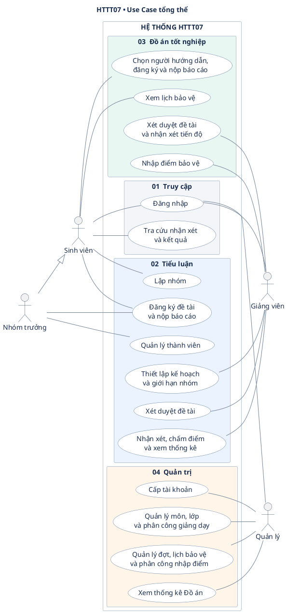
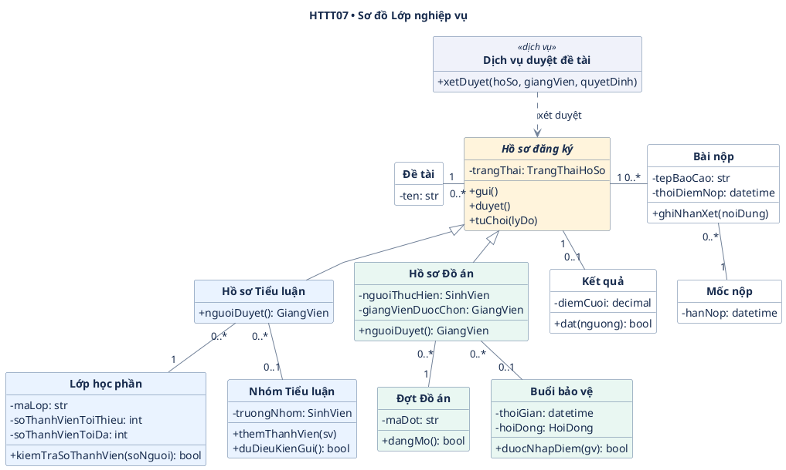
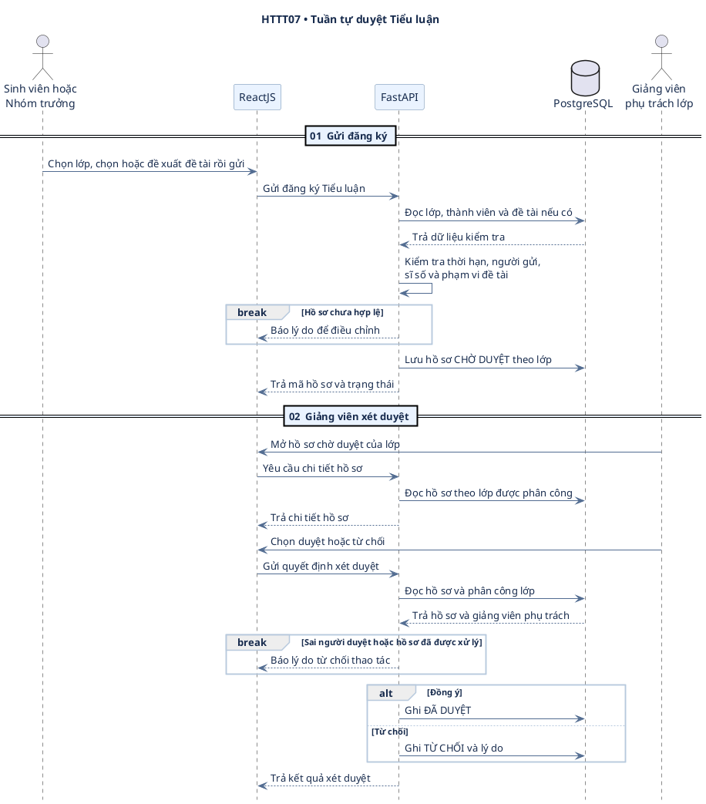
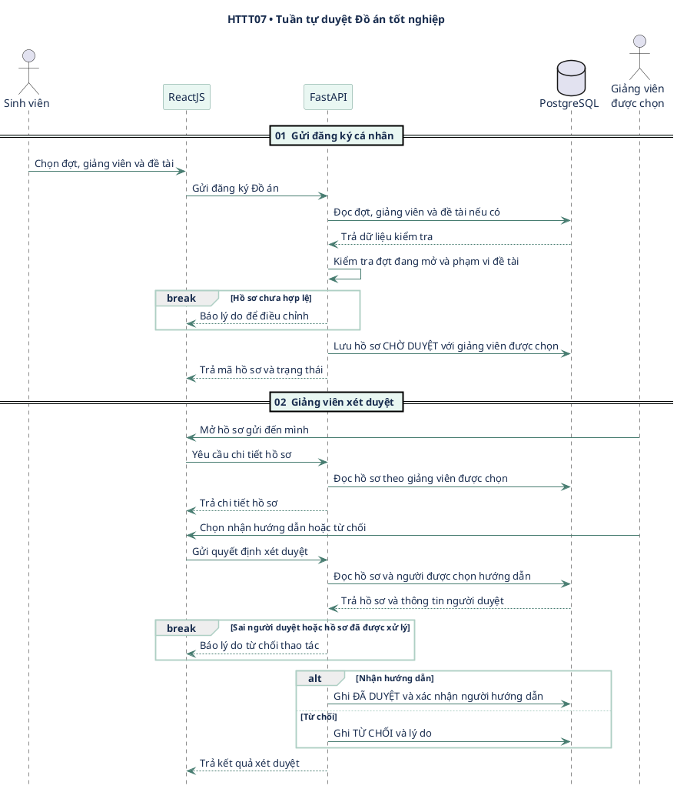
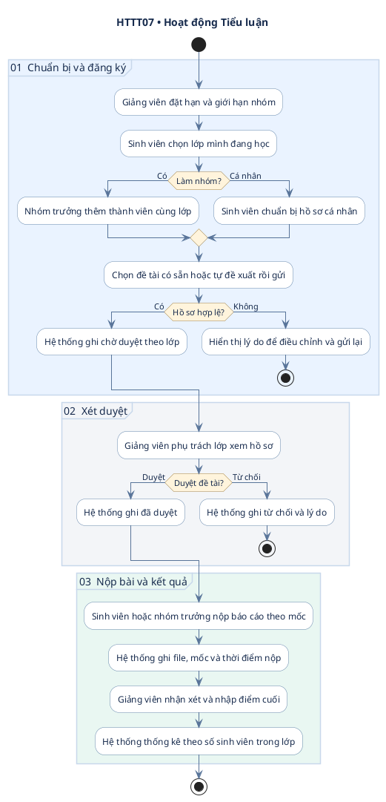
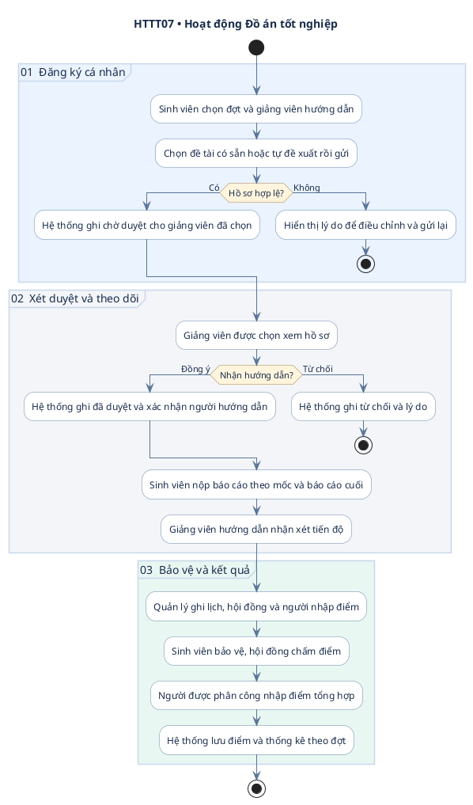
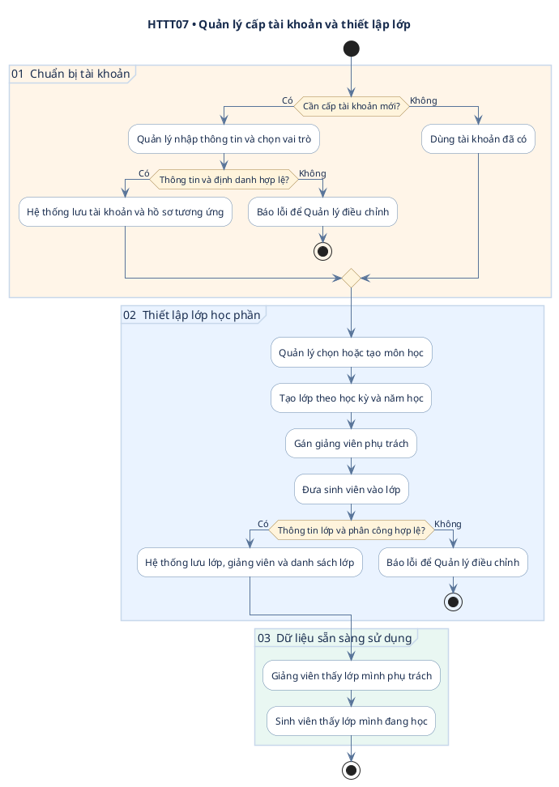
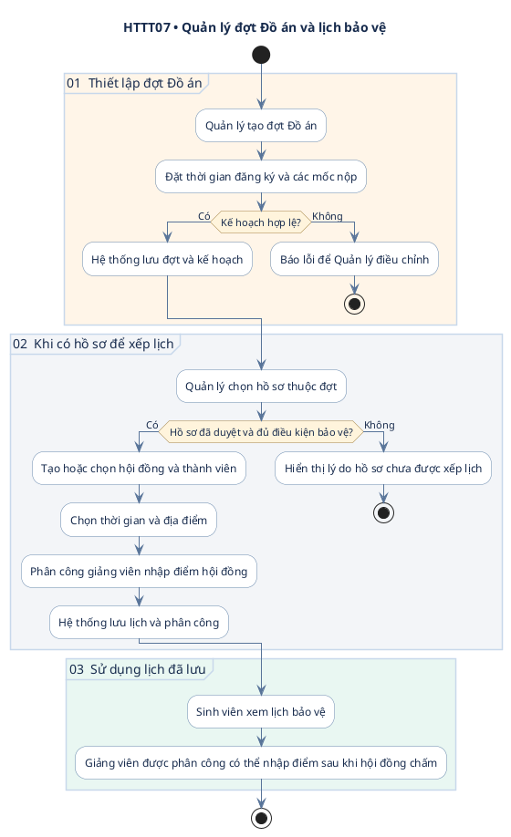

# HTTT07 — Sơ đồ UML

Tám sơ đồ PlantUML mô tả hai quy trình và các hoạt động của Quản lý trong HTTT07. Để xem một sơ đồ, sao chép cả khối từ dòng @startuml đến dòng @enduml vào trình xem PlantUML.

| Mục | Sơ đồ | Cách đọc |
| --- | --- | --- |
| 1 | Use Case | Nhìn theo vai trò và nhóm chức năng. |
| 2 | Lớp | Bắt đầu từ Hồ sơ đăng ký, sau đó xem từng nhánh. |
| 3.1–3.2 | Tuần tự | Đọc từ gửi hồ sơ đến quyết định của giảng viên. |
| 4.1–4.2 | Hoạt động | Tiểu luận và Đồ án từ đăng ký đến kết quả. |
| 4.3–4.4 | Hoạt động của Quản lý | Cấp tài khoản, thiết lập lớp, quản lý đợt và lịch bảo vệ. |

## 1. Use Case tổng thể

- **Tiểu luận:** Sinh viên xem lớp mình đang học và tự đăng ký, nộp bài nếu làm cá nhân. Nhóm trưởng quản lý thành viên và thực hiện hai thao tác đó thay mặt nhóm.
- **Đồ án:** Sinh viên xem đợt đang mở, chọn giảng viên hướng dẫn và đăng ký cá nhân. Giảng viên được phân công nhập điểm sau khi hội đồng chấm.
- Ở cả hai luồng, người đăng ký có thể chọn đề tài có sẵn hoặc tự đề xuất.

## 2. Sơ đồ Lớp theo hướng đối tượng

Đọc từ lớp trung tâm **Hồ sơ đăng ký**. Tiểu luận và Đồ án cùng kế thừa thao tác gửi, duyệt và từ chối. Phần khác nhau nằm ở **cách tìm người duyệt** và **người thực hiện hồ sơ**.

| Nhìn vào | Cách hiểu |
| --- | --- |
| Dòng có dấu trừ | Thuộc tính nội bộ. Ví dụ, lớp học phần giữ giới hạn số thành viên. |
| Dòng có dấu cộng | Phương thức có thể gọi từ bên ngoài. Ví dụ, hàm kiểm tra sĩ số trả về đúng hoặc sai. |
| Mũi tên tam giác rỗng | Kế thừa. Hai loại hồ sơ dùng chung các thao tác của Hồ sơ đăng ký. |
| Số ở đầu đường nối | Số lượng. Ví dụ, một hồ sơ có từ 0 đến nhiều bài nộp và từ 0 đến 1 kết quả. |

Hồ sơ Tiểu luận lấy người duyệt từ giảng viên phụ trách lớp. Hồ sơ có một người làm cá nhân hoặc một nhóm. Hồ sơ Đồ án lấy người duyệt từ giảng viên được sinh viên chọn. Mỗi mốc nộp thuộc một lớp học phần hoặc một đợt đồ án.

Bản tổng quan tập trung vào các lớp trực tiếp xử lý hai quy trình. Tài khoản, Sinh viên, Giảng viên, Môn học, Hội đồng và Dịch vụ đăng ký là các lớp hỗ trợ trong thiết kế chi tiết. Số bảng và các khóa PostgreSQL được xác định trong ERD.

## 3. Sơ đồ Tuần tự duyệt đề tài

Người gửi và người duyệt đã đăng nhập. FastAPI xác thực JWT và kiểm tra quyền theo phạm vi của hồ sơ. Thao tác gửi và thao tác xét duyệt có thể diễn ra ở hai thời điểm khác nhau.

### 3.1. Tiểu luận

### 3.2. Đồ án tốt nghiệp

## 4. Sơ đồ Hoạt động

### 4.1. Tiểu luận theo lớp học phần

### 4.2. Đồ án tốt nghiệp cá nhân

### 4.3. Quản lý cấp tài khoản và thiết lập lớp học phần

Quản lý đã đăng nhập. Đây là luồng chuẩn bị dữ liệu trước khi sinh viên và giảng viên bắt đầu sử dụng các chức năng Tiểu luận. Có thể dùng lại tài khoản và môn học đã có.

### 4.4. Quản lý đợt Đồ án và lịch bảo vệ

Quản lý thực hiện hai việc ở hai thời điểm. Đợt được thiết lập trước khi sinh viên đăng ký. Lịch bảo vệ được xếp sau khi có hồ sơ đủ điều kiện.

Quản lý có thể xem thống kê theo đợt ở bất kỳ thời điểm nào. Khi chưa có điểm, hồ sơ đã duyệt được tính vào nhóm chưa chấm theo phương án ERD hiện tại. Điều kiện cụ thể để hồ sơ đủ điều kiện bảo vệ cần chốt trước khi triển khai tính năng xếp lịch.

## Ghi chú nghiệp vụ

- Tiểu luận kiểm tra người gửi, tư cách thuộc lớp, thời gian đăng ký và số thành viên. Nhóm trưởng được tính vào sĩ số.
- Bản thiết kế dùng phương án một điểm chung cho nhóm Tiểu luận và một điểm tổng hợp của hội đồng cho mỗi hồ sơ Đồ án. Thống kê đếm theo sinh viên.
- Ngưỡng đạt và cách xử lý nộp trễ cần xác nhận theo quy định của môn hoặc đợt. Nhánh yêu cầu chỉnh sửa đề tài là chức năng bổ sung.

