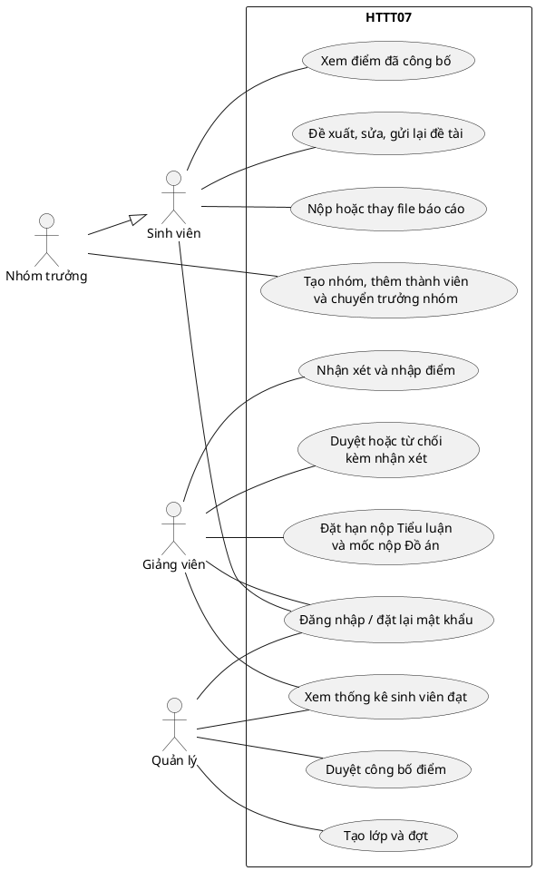
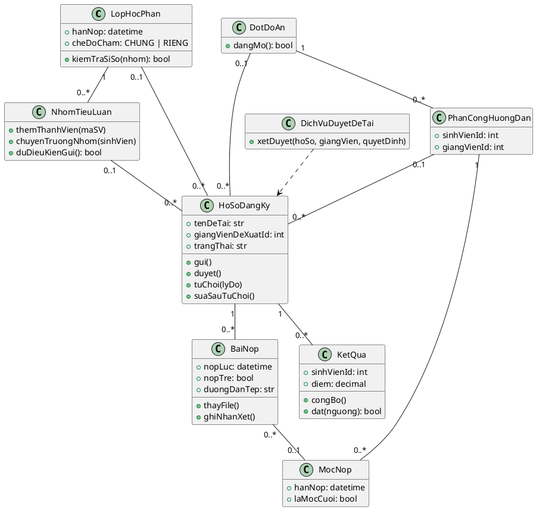
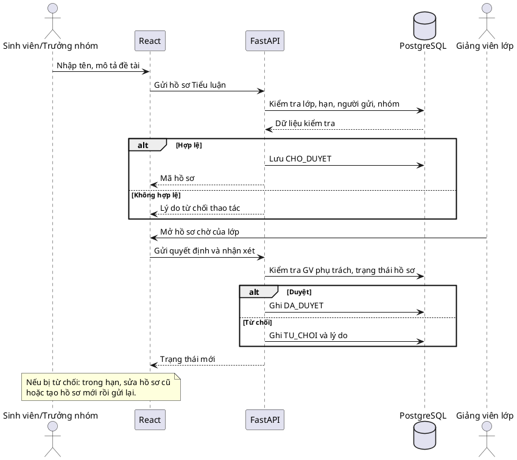
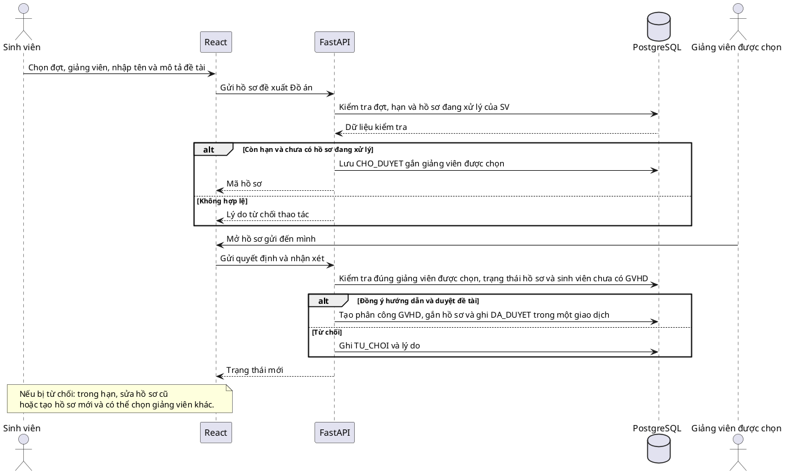
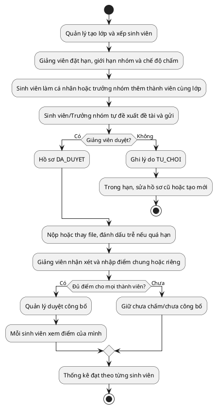
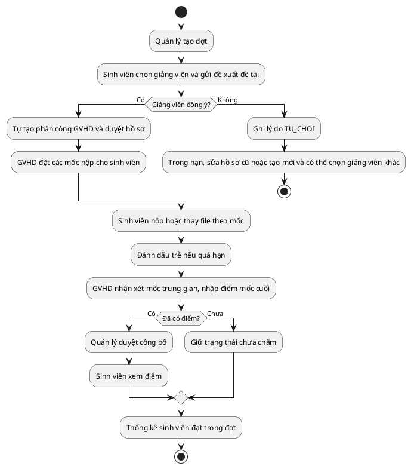

# HTTT07 — Sơ đồ UML cho phạm vi bản đầu

Sáu sơ đồ PlantUML gồm Use Case, Lớp, hai sơ đồ Tuần tự duyệt đề tài và hai sơ đồ Hoạt động. Sao chép từng khối `@startuml` đến `@enduml` vào PlantUML để xem hình. Sơ đồ mô tả **nghiệp vụ bản đầu** trong [file 01](01-phan-tich-nghiep-vu.md); tên bảng và ràng buộc ở [file 04](04-thiet-ke-co-so-du-lieu.md).

## 1. Use Case tổng thể

Sinh viên tự đề xuất đề tài; không có chức năng chọn đề tài do giảng viên cung cấp trong bản đầu. Với Đồ án, sinh viên chọn giảng viên nhận đề xuất; khi giảng viên duyệt, hệ thống tự ghi nhận phân công GVHD. Trưởng nhóm Tiểu luận thêm sinh viên cùng lớp bằng mã; chỉ trưởng nhóm gửi hồ sơ và nộp bài thay nhóm.

## 2. Sơ đồ Lớp nghiệp vụ

Hồ sơ Tiểu luận gắn lớp, có thể gắn nhóm; hồ sơ Đồ án gắn đợt và giảng viên được chọn. Khi giảng viên duyệt, hồ sơ mới gắn phân công GVHD. Tiểu luận lấy hạn từ lớp, Đồ án lấy hạn từ mốc do GVHD của phân công đó đặt. `BaiNop` giữ đường dẫn nội bộ; file thật lưu ở `BE/storage/reports/` và chỉ tải qua API có kiểm tra quyền. `KetQua` ứng với **một sinh viên trong một hồ sơ**; điểm chung ghi cùng giá trị cho các thành viên, điểm riêng ghi từng giá trị. Quản lý chỉ công bố khi hồ sơ đã đủ điểm.

## 3. Sơ đồ Tuần tự duyệt đề tài

### 3.1. Tiểu luận

### 3.2. Đồ án tốt nghiệp

## 4. Sơ đồ Hoạt động

### 4.1. Tiểu luận

### 4.2. Đồ án tốt nghiệp

## Phạm vi chưa triển khai

Sơ đồ không có kho đề tài gợi ý, lời mời xác nhận nhóm, hội đồng, lịch bảo vệ hoặc điểm từng giám khảo. Email đặt lại mật khẩu thuộc chức năng tài khoản; nộp trễ và Quản lý duyệt công bố thuộc bản đầu.
