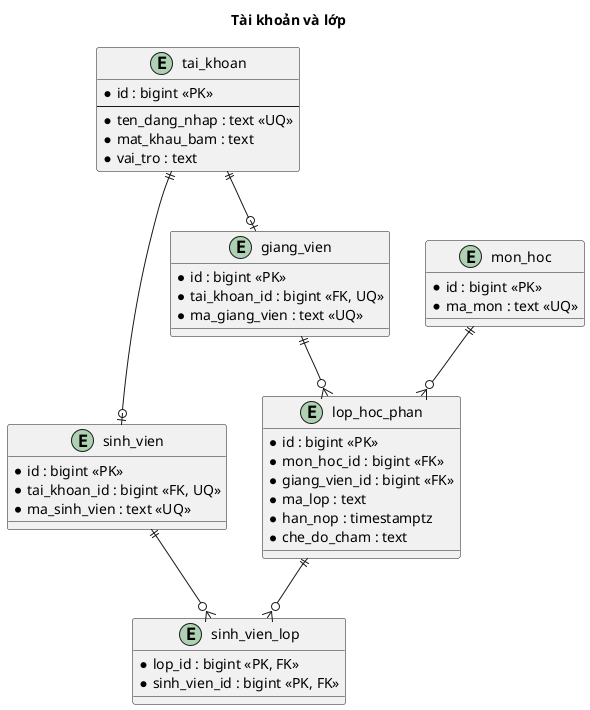
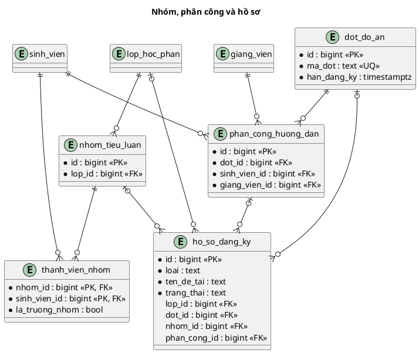
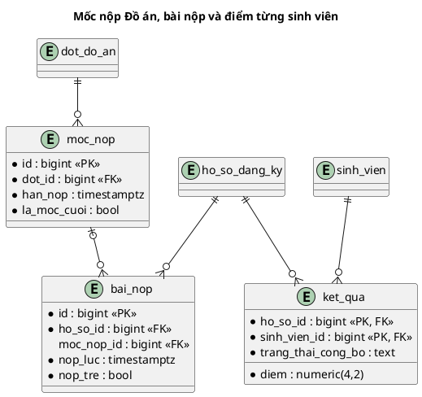

# HTTT07 — Thiết kế cơ sở dữ liệu PostgreSQL (bản đầu)

Thiết kế dự kiến **14 bảng** cho hai luồng. Hồ sơ tự lưu tên/mô tả đề tài; chưa có kho đề tài gợi ý, hội đồng hay lịch bảo vệ. Điểm được lưu **mỗi sinh viên một dòng**, nên Tiểu luận hỗ trợ cả chấm chung và chấm riêng mà không tạo cột theo số thành viên.

| Nhóm | Số bảng | Các bảng |
| --- | ---: | --- |
| Tài khoản và lớp | 6 | `tai_khoan`, `sinh_vien`, `giang_vien`, `mon_hoc`, `lop_hoc_phan`, `sinh_vien_lop` |
| Đăng ký | 5 | `dot_do_an`, `phan_cong_huong_dan`, `nhom_tieu_luan`, `thanh_vien_nhom`, `ho_so_dang_ky` |
| Nộp bài và kết quả | 3 | `moc_nop`, `bai_nop`, `ket_qua` |

PK = khóa chính; FK = khóa ngoại; UQ = duy nhất; dấu `?` = có thể trống. Các sơ đồ ERD dưới đây dùng PlantUML.

## 1. Tài khoản và lớp — 6 bảng

| Bảng | Cột chính và quy tắc |
| --- | --- |
| `tai_khoan` | `id`, `ten_dang_nhap`, `mat_khau_bam`, `vai_tro` (`QUAN_LY`, `GIANG_VIEN`, `SINH_VIEN`), `reset_token_hash?`, `reset_expires_at?`. Email dùng làm tên đăng nhập; chỉ lưu mã băm token đặt lại mật khẩu và thời hạn, xóa sau khi dùng. |
| `sinh_vien`, `giang_vien` | Mỗi dòng có `tai_khoan_id` duy nhất, mã sinh viên/giảng viên duy nhất và `ho_ten`. |
| `mon_hoc` | `id`, `ma_mon` duy nhất, `ten_mon`. |
| `lop_hoc_phan` | `id`, `mon_hoc_id`, `giang_vien_id`, `ma_lop`, `hoc_ky`, `nam_hoc`, `bat_dau_dang_ky?`, `han_dang_ky?`, `han_nop?`, `so_thanh_vien_toi_thieu`, `so_thanh_vien_toi_da`, `che_do_cham` (`CHUNG` hoặc `RIENG`), `nguong_dat` mặc định 4,0. Một lớp chỉ có một hạn nộp Tiểu luận. |
| `sinh_vien_lop` | PK ghép `(lop_id, sinh_vien_id)`; dùng để kiểm tra sinh viên thuộc lớp. |

## 2. Đăng ký — 5 bảng

| Bảng | Cột chính và quy tắc |
| --- | --- |
| `dot_do_an` | `id`, `ma_dot`, `ten_dot`, `bat_dau_dang_ky`, `han_dang_ky`, `nguong_dat` mặc định 4,0. |
| `phan_cong_huong_dan` | `id`, `dot_id`, `sinh_vien_id`, `giang_vien_id`; UQ `(dot_id, sinh_vien_id)`. Quản lý gán trước khi sinh viên đăng ký. Hồ sơ Đồ án tham chiếu phân công này, không cho sinh viên tự chọn GVHD. |
| `nhom_tieu_luan` | `id`, `lop_id`, `ten_nhom`. Nhóm thuộc một lớp. |
| `thanh_vien_nhom` | PK `(nhom_id, sinh_vien_id)`, thêm `lop_id`, `la_truong_nhom`. Không có trạng thái lời mời; trưởng nhóm thêm sinh viên cùng lớp bằng mã. UQ `(lop_id, sinh_vien_id)` chặn ở hai nhóm trong một lớp. |
| `ho_so_dang_ky` | `id`, `loai`, `ten_de_tai`, `mo_ta`, `sinh_vien_gui_id`, `lop_id?`, `dot_id?`, `nhom_id?`, `phan_cong_id?`, `nguong_dat?`, `trang_thai`, `lan_gui`, `gui_luc?`, `nguoi_duyet_id?`, `duyet_luc?`, `ly_do_tu_choi?`. Đề tài tự đề xuất nằm trong hồ sơ; `nguong_dat` chỉ dùng cho Đồ án, mặc định 4,0 và GVHD được chỉnh trước khi công bố. |

Hồ sơ Tiểu luận có `lop_id` và tùy chọn `nhom_id`; hồ sơ Đồ án có `dot_id`, `phan_cong_id`, không có `lop_id` hay `nhom_id`. `phan_cong_id` phải khớp cùng đợt và sinh viên gửi hồ sơ. Tiểu luận lấy người duyệt từ lớp; Đồ án lấy từ phân công GVHD.

Trạng thái: `NHAP → CHO_DUYET → DA_DUYET` hoặc `TU_CHOI`. Trong hạn đăng ký, hồ sơ `TU_CHOI` được sửa rồi gửi lại (tăng `lan_gui`, giữ cùng `id`) hoặc người dùng tạo hồ sơ mới; hồ sơ cũ được giữ. Chỉ một hồ sơ `CHO_DUYET`/`DA_DUYET` cho mỗi người hoặc nhóm trong cùng phạm vi.

## 3. Nộp bài và kết quả — 3 bảng

| Bảng | Cột chính và quy tắc |
| --- | --- |
| `moc_nop` | `id`, `dot_id`, `ten_moc`, `thu_tu`, `han_nop`, `la_moc_cuoi`. Chỉ Đồ án có nhiều mốc; một mốc cuối cho mỗi đợt. |
| `bai_nop` | `id`, `ho_so_id`, `moc_nop_id?`, `nguoi_nop_id`, `duong_dan_tep`, `ten_tep_goc`, `nop_luc`, `nop_tre`, `nhan_xet?`, `nguoi_nhan_xet_id?`, `nhan_xet_luc?`. Tiểu luận có `moc_nop_id = NULL` và so với `lop_hoc_phan.han_nop`; Đồ án phải có mốc cùng đợt. Lưu một file hiện hành cho mỗi hồ sơ/mốc. |
| `ket_qua` | PK `(ho_so_id, sinh_vien_id)`, `diem`, `nguoi_nhap_id`, `nhap_luc`, `trang_thai_cong_bo`, `nguoi_cong_bo_id?`, `cong_bo_luc?`. Mỗi sinh viên của hồ sơ có một điểm. Chỉ Quản lý công bố; sinh viên chỉ thấy dòng điểm của mình đã công bố. |

## 4. Ràng buộc khi viết migration và service

| Quy tắc | Cách bảo đảm |
| --- | --- |
| Thành viên đúng lớp và nhóm | FK ghép `(lop_id, sinh_vien_id)` tới `sinh_vien_lop`, FK ghép `(nhom_id, lop_id)` tới nhóm. UQ `(lop_id, sinh_vien_id)` ở bảng thành viên. Chỉ mục duy nhất có điều kiện đảm bảo mỗi nhóm đúng một trưởng nhóm. Chuyển trưởng nhóm trong một giao dịch. |
| Giới hạn nhóm và hồ sơ | Service khóa nhóm/lớp khi thêm thành viên hoặc gửi hồ sơ; kiểm tra sĩ số, quyền trưởng nhóm và hồ sơ cá nhân/nhóm xung đột. Không sửa thành viên sau khi gửi hồ sơ. |
| Phân công GVHD | UQ `(dot_id, sinh_vien_id)`; service kiểm tra `phan_cong_id` đúng đợt, sinh viên và giảng viên xét duyệt. |
| Mốc Đồ án | UQ `(dot_id, thu_tu)` và chỉ mục duy nhất có điều kiện trên `dot_id` khi `la_moc_cuoi = true`; trước khi mở đợt phải có đúng một mốc cuối. |
| Hồ sơ đang xử lý | Chỉ mục duy nhất có điều kiện cho `CHO_DUYET`, `DA_DUYET` theo lớp/nhóm hoặc đợt/sinh viên. Hồ sơ `TU_CHOI` không chiếm suất. |
| Bài nộp hiện hành | UQ có điều kiện trên `ho_so_id` khi `moc_nop_id IS NULL` cho Tiểu luận; UQ `(ho_so_id, moc_nop_id)` khi mốc có giá trị cho Đồ án. Khi thay file, cập nhật `nop_luc`, `nop_tre`; nộp trễ vẫn nhận. |
| Điểm và công bố | CHECK `0 <= diem <= 10`. Điểm chung: service ghi cùng điểm vào từng dòng `ket_qua` của thành viên; điểm riêng: ghi từng dòng theo điểm giảng viên nhập. Đổi `che_do_cham` sau khi đã chấm phải bị chặn. Chỉ công bố khi mọi thành viên hồ sơ có điểm; công bố cả nhóm trong một giao dịch. |

Chưa có dòng `ket_qua` thì sinh viên là **chưa chấm**. Thống kê theo số sinh viên thuộc hồ sơ đã duyệt: có điểm dưới ngưỡng là không đạt, đạt ngưỡng là đạt, thiếu điểm là chưa chấm. Quản lý xem thống kê nội bộ; sinh viên chỉ xem điểm đã công bố. Ngưỡng Tiểu luận lấy từ lớp; ngưỡng Đồ án lấy từ hồ sơ, mặc định 4,0; chốt trước khi công bố để kết quả không đổi sau khi sinh viên đã xem.

Dùng `bigint` cho ID, `timestamptz` cho thời điểm và `numeric(4,2)` cho điểm. Các quy tắc liên quan nhiều dòng cần giao dịch hoặc chỉ mục, không thể chỉ dùng `CHECK`. Tham khảo [ràng buộc PostgreSQL](https://www.postgresql.org/docs/current/ddl-constraints.html) và [chỉ mục có điều kiện](https://www.postgresql.org/docs/current/indexes-partial.html).

Thiết kế này **chưa có migration chạy được**. Cần kiểm tra ERD với giảng viên trước khi tạo migration đầu tiên, nhất là việc không lưu hội đồng/lịch bảo vệ trong bản nộp.
