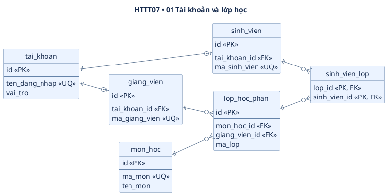
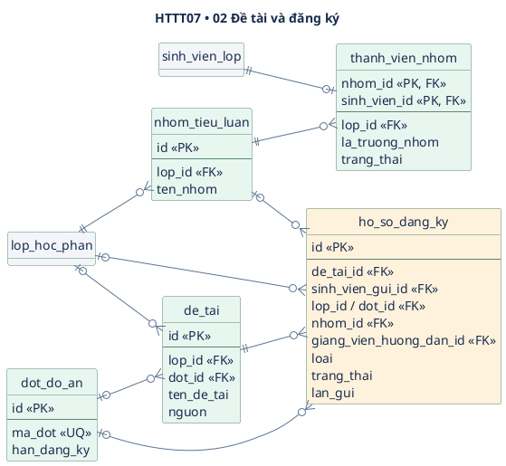
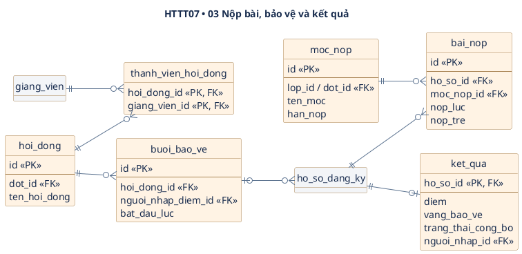

# HTTT07 — Thiết kế cơ sở dữ liệu PostgreSQL

Phương án có **17 bảng**, chia thành ba nhóm. **Hồ sơ đăng ký** là bảng trung tâm, nối đề tài với người thực hiện, bài nộp và kết quả. Tiểu luận và Đồ án dùng chung cấu trúc hồ sơ, mỗi luồng có điều kiện dữ liệu riêng.

| Nhóm | Số bảng | Câu hỏi trả lời |
| --- | ---: | --- |
| Tài khoản và lớp học | 6 | Ai đăng nhập, học lớp nào, giảng viên nào phụ trách? |
| Đề tài và đăng ký | 5 | Ai đăng ký đề tài gì, theo lớp hay đợt, hồ sơ đang ở trạng thái nào? |
| Nộp bài, bảo vệ và kết quả | 6 | Nộp file vào mốc nào, ai nhận xét, ai ghi điểm? |

**Cách đọc ERD.** PK là khóa chính, FK là khóa ngoại, UQ là giá trị hoặc tổ hợp giá trị duy nhất. Dấu ? trong danh mục cột nghĩa là có thể để trống. Bảng màu xám là bảng đã xuất hiện ở phần khác và được lặp lại để thấy quan hệ. Sơ đồ hiển thị các cột và đường nối chính. Danh mục dưới từng hình ghi đầy đủ cột dự kiến. Để xem hình, sao chép từng khối từ @startuml đến @enduml vào PlantUML.

## 1. Tài khoản và lớp học — 6 bảng

| Bảng | Cột cần lưu | Ý nghĩa |
| --- | --- | --- |
| **tai_khoan** | id, ten_dang_nhap, mat_khau_bam, vai_tro | Quản lý cấp tài khoản. Tên đăng nhập duy nhất. Vai trò gồm QUAN_LY, GIANG_VIEN, SINH_VIEN. |
| **sinh_vien** | id, tai_khoan_id, ma_sinh_vien, ho_ten | Mã sinh viên và tai_khoan_id đều duy nhất. |
| **giang_vien** | id, tai_khoan_id, ma_giang_vien, ho_ten | Mã giảng viên và tai_khoan_id đều duy nhất. |
| **mon_hoc** | id, ma_mon, ten_mon | Mã môn duy nhất. Một môn có thể mở nhiều lớp. |
| **lop_hoc_phan** | id, mon_hoc_id, giang_vien_id, ma_lop, hoc_ky, nam_hoc, bat_dau_dang_ky?, han_dang_ky?, so_thanh_vien_toi_thieu, so_thanh_vien_toi_da, nguong_dat? | Mỗi lớp có một giảng viên phụ trách. Tổ hợp ma_lop, hoc_ky, nam_hoc là duy nhất. |
| **sinh_vien_lop** | lop_id, sinh_vien_id | Khóa chính ghép (lop_id, sinh_vien_id). Một dòng cho biết sinh viên thuộc lớp nào. |

## 2. Đề tài và đăng ký — 5 bảng

| Bảng | Cột cần lưu | Ý nghĩa |
| --- | --- | --- |
| **dot_do_an** | id, ma_dot, ten_dot, bat_dau_dang_ky, han_dang_ky, nguong_dat? | Một đợt Đồ án. Mã đợt duy nhất. |
| **nhom_tieu_luan** | id, lop_id, ten_nhom | Nhóm thuộc đúng một lớp. Giới hạn sĩ số lấy từ lớp. |
| **thanh_vien_nhom** | nhom_id, sinh_vien_id, lop_id, la_truong_nhom, trang_thai | Khóa chính ghép (nhom_id, sinh_vien_id). Trạng thái MOI hoặc DA_XAC_NHAN; chỉ người đã xác nhận được tính vào nhóm. Trưởng nhóm là thành viên đã xác nhận có la_truong_nhom = true. Lời mời bị từ chối được xóa. |
| **de_tai** | id, ten_de_tai, mo_ta, nguon, lop_id?, dot_id?, giang_vien_id?, nguoi_de_xuat_id? | Nguồn là CO_SAN hoặc TU_DE_XUAT. Đề tài Tiểu luận thuộc một lớp. Đề tài Đồ án thuộc một đợt và gắn với một giảng viên. Người tự đề xuất tham chiếu sinh_vien. |
| **ho_so_dang_ky** | id, loai, de_tai_id, sinh_vien_gui_id, lop_id?, dot_id?, nhom_id?, giang_vien_huong_dan_id?, trang_thai, lan_gui, gui_luc?, nguoi_duyet_id?, duyet_luc?, ly_do_tu_choi?, buoi_bao_ve_id? | Lưu hồ sơ và quyết định xét duyệt mới nhất. lan_gui tăng khi sửa hồ sơ bị từ chối và gửi lại. sinh_vien_gui_id tham chiếu sinh_vien. Hai cột giảng viên tham chiếu giang_vien. buoi_bao_ve_id dùng cho Đồ án. |

| Loại hồ sơ | Dữ liệu nhận diện | Người gửi và người duyệt |
| --- | --- | --- |
| **Tiểu luận cá nhân** | loai = TIEU_LUAN, có lop_id | Sinh viên gửi. Giảng viên phụ trách lớp duyệt. |
| **Tiểu luận nhóm** | loai = TIEU_LUAN, có lop_id và nhom_id | Trưởng nhóm gửi thay mặt nhóm. Giảng viên phụ trách lớp duyệt. |
| **Đồ án cá nhân** | loai = DO_AN, có dot_id và giang_vien_huong_dan_id | Sinh viên gửi. Giảng viên được chọn xét duyệt và trở thành người hướng dẫn khi duyệt. |

Trạng thái hồ sơ gồm **NHAP → CHO_DUYET → DA_DUYET hoặc TU_CHOI**. Từ TU_CHOI, người gửi có hai lựa chọn trong hạn đăng ký: sửa chính hồ sơ đó (trở về NHAP rồi gửi lại, tăng lan_gui và xóa thông tin xét duyệt cũ) hoặc tạo hồ sơ mới; hồ sơ cũ vẫn giữ TU_CHOI. Chỉ được có một hồ sơ CHO_DUYET hoặc DA_DUYET trong cùng phạm vi. Khi gửi, API kiểm tra đợt hoặc lớp còn mở, đề tài đúng phạm vi và người gửi có quyền. Khi xét duyệt, API kiểm tra người duyệt và hồ sơ còn ở trạng thái CHO_DUYET.

## 3. Nộp bài, bảo vệ và kết quả — 6 bảng

| Bảng | Cột cần lưu | Ý nghĩa |
| --- | --- | --- |
| **moc_nop** | id, lop_id?, dot_id?, ten_moc, loai, han_nop | Mỗi mốc thuộc một lớp hoặc một đợt. Loại gồm DINH_KY và BAO_CAO_CUOI. |
| **bai_nop** | id, ho_so_id, moc_nop_id, nguoi_nop_id, duong_dan_tep, ten_tep_goc, nop_luc, nop_tre, nhan_xet?, nguoi_nhan_xet_id?, nhan_xet_luc? | Một bài hiện hành cho mỗi cặp hồ sơ và mốc; được thay file, ghi thời điểm lần nộp mới nhất và nop_tre = true nếu thời điểm đó quá hạn. Người nộp tham chiếu sinh_vien. Người nhận xét tham chiếu giang_vien. PostgreSQL lưu thông tin file; nội dung file ở thư mục backend. |
| **hoi_dong** | id, dot_id, ten_hoi_dong | Hội đồng thuộc một đợt Đồ án. |
| **thanh_vien_hoi_dong** | hoi_dong_id, giang_vien_id | Khóa chính ghép (hoi_dong_id, giang_vien_id). |
| **buoi_bao_ve** | id, hoi_dong_id, bat_dau_luc, dia_diem, nguoi_nhap_diem_id? | Một buổi có thể chứa nhiều hồ sơ cùng đợt. Người được phân công nhập điểm tham chiếu giang_vien. |
| **ket_qua** | ho_so_id, diem?, vang_bao_ve, nguoi_nhap_id, nhap_luc, trang_thai_cong_bo, nguoi_cong_bo_id?, cong_bo_luc? | ho_so_id vừa là PK vừa là FK. Với Đồ án, có điểm hoặc xác nhận vắng bảo vệ; vắng thì không đạt dù không có điểm. Người nhập tham chiếu tai_khoan: giảng viên được phân công nhập điểm, Quản lý xác nhận vắng. Chỉ Quản lý được chuyển CHO_CONG_BO sang DA_CONG_BO; sinh viên chỉ xem kết quả đã công bố. |

## 4. Ràng buộc cần đưa vào migration và backend

| Quy tắc | Cách thực hiện dự kiến |
| --- | --- |
| Mỗi sinh viên thuộc tối đa một nhóm trong cùng lớp | Chỉ mục duy nhất có điều kiện trên (lop_id, sinh_vien_id) khi trang_thai = DA_XAC_NHAN. FK ghép (lop_id, sinh_vien_id) trỏ tới sinh_vien_lop. FK ghép (nhom_id, lop_id) trỏ tới cặp duy nhất tương ứng ở nhom_tieu_luan để bảo đảm cùng lớp. Khi xác nhận lời mời, kiểm tra trùng nhóm và sĩ số trong giao dịch. |
| Nhóm có đúng một trưởng nhóm và đủ người khi gửi | Chỉ mục duy nhất có điều kiện trên nhom_id khi la_truong_nhom = true. Backend bảo đảm trưởng nhóm đã xác nhận; chỉ trưởng nhóm hiện tại được chuyển quyền cho thành viên đã xác nhận, thực hiện trong giao dịch. Chỉ đếm thành viên đã xác nhận khi gửi và giữ danh sách nhóm cố định sau khi gửi. |
| Hồ sơ và mốc nộp có phạm vi đúng | CHECK để mỗi dòng mang đúng phạm vi lớp hoặc đợt. Đề tài tự đề xuất cần có người đề xuất. Hồ sơ Tiểu luận có lớp, có thể có nhóm, bỏ trống thông tin hướng dẫn và bảo vệ. Hồ sơ Đồ án có đợt và giảng viên hướng dẫn, bỏ trống lớp và nhóm. Backend đối chiếu đề tài, nhóm, lịch bảo vệ và mốc nộp với phạm vi hồ sơ. |
| Mỗi người có một hồ sơ đang xử lý trong cùng phạm vi | Với trạng thái CHO_DUYET hoặc DA_DUYET, dùng chỉ mục duy nhất có điều kiện cho (lop_id, sinh_vien_gui_id) của Tiểu luận cá nhân, nhom_id của Tiểu luận nhóm và (dot_id, sinh_vien_gui_id) của Đồ án. Hồ sơ TU_CHOI được giữ lại và không chiếm suất đăng ký. Với xung đột giữa hồ sơ cá nhân và thành viên nhóm, backend khóa dòng lop_hoc_phan, kiểm tra toàn bộ thành viên đã xác nhận và ghi hồ sơ trong cùng giao dịch. |
| Bài nộp và kết quả thuộc đúng người | UQ trên (ho_so_id, moc_nop_id) ở bai_nop. Backend kiểm tra hồ sơ đã duyệt và người nộp hợp lệ; khi thay file, cập nhật nop_luc và nop_tre theo hạn mốc. CHECK ở ket_qua: Tiểu luận phải có điểm và không vắng; Đồ án có điểm hoặc xác nhận vắng, không được cả hai. Điểm Tiểu luận do giảng viên lớp nhập, điểm Đồ án do giảng viên được phân công nhập; Quản lý xác nhận vắng và công bố kết quả. |

Đề xuất dùng bigint cho ID, timestamptz cho thời điểm, text cho nội dung và numeric(4,2) cho điểm. Kiểm tra số thành viên tối thiểu từ 1 trở lên và không vượt tối đa. Lớp có thể chưa cấu hình thời gian đăng ký. Khi mở đăng ký, cần có đủ mốc bắt đầu và kết thúc theo đúng thứ tự.

CHECK áp dụng cho dữ liệu trong cùng một dòng. Quy tắc qua nhiều dòng dùng khóa, chỉ mục hoặc giao dịch nghiệp vụ tùy trường hợp. [Ràng buộc PostgreSQL](https://www.postgresql.org/docs/current/ddl-constraints.html) · [Chỉ mục có điều kiện](https://www.postgresql.org/docs/current/indexes-partial.html)

## 5. Giả định cần rà trước khi viết migration

- **Điểm nhóm.** Phương án hiện tại lưu một điểm chung cho nhóm. Ví dụ, nhóm 4 người đạt được tính là 4 sinh viên đạt. Đề xuất giữ danh sách thành viên ổn định từ khi hồ sơ được gửi để kết quả gắn đúng người.
- **Phạm vi thống kê.** Đề xuất tính trên hồ sơ đã duyệt. Hồ sơ chưa có điểm và chưa được xác nhận vắng thuộc nhóm chưa chấm, kể cả khi đã qua ngày bảo vệ. Hồ sơ được xác nhận vắng bảo vệ thuộc nhóm không đạt. Với hồ sơ có điểm, ngưỡng của lớp hoặc đợt quyết định đạt hay không đạt. Quản lý xem thống kê nội bộ; sinh viên chỉ xem kết quả đã công bố.
- **Quy định còn mở.** Cần chốt thang điểm và ngưỡng đạt. Bài nộp trễ vẫn được nhận và đánh dấu trễ; được thay file, chỉ lưu bài hiện hành mỗi mốc. Khi sửa hồ sơ bị từ chối rồi gửi lại, bảng hồ sơ chỉ lưu quyết định xét duyệt mới nhất.
- **Bước triển khai.** Tạo migration theo thứ tự tài khoản và lớp, đợt và đăng ký, sau đó nộp bài và bảo vệ. Thêm FK từ hồ sơ tới buổi bảo vệ sau khi có bảng buoi_bao_ve. Chạy thử migration trên database trống trước khi nhập dữ liệu mẫu.

