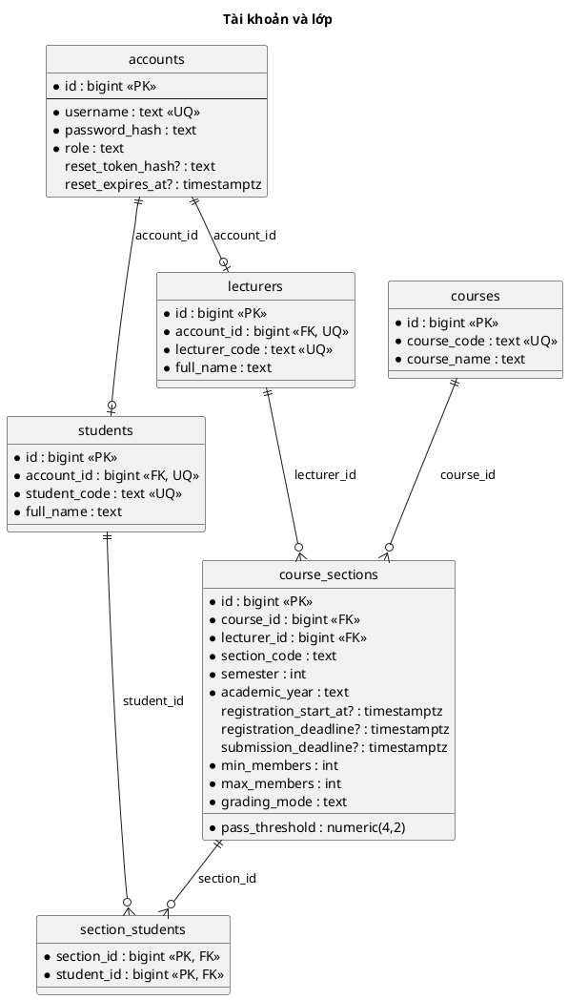
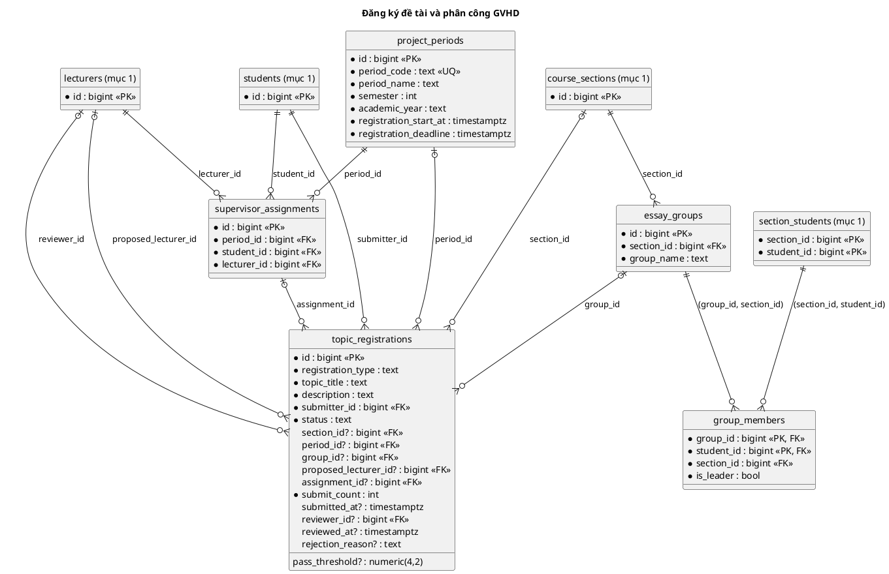
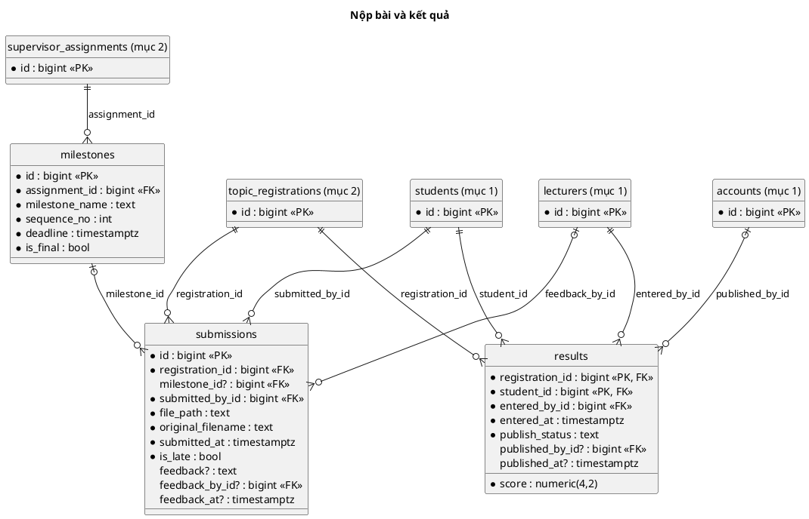

# HTTT07 — Thiết kế cơ sở dữ liệu PostgreSQL (bản đầu, đặt tên tiếng Anh)

Thiết kế dự kiến **14 bảng** cho hai luồng. Hồ sơ tự lưu tên/mô tả đề tài; chưa có kho đề tài gợi ý, hội đồng hay lịch bảo vệ. Điểm được lưu **mỗi sinh viên một dòng**, nên Tiểu luận hỗ trợ cả chấm chung và chấm riêng mà không tạo cột theo số thành viên.

> **Quy ước đặt tên:** bảng `snake_case` số nhiều, lớp Python `PascalCase` số ít, cột `snake_case`, giá trị enum `UPPER_SNAKE_CASE`. Giao diện vẫn hiển thị tiếng Việt. Nội dung giải thích trong tài liệu giữ tiếng Việt, chỉ tên định danh (bảng, cột, enum) là tiếng Anh. Bảng đối chiếu với bản tiếng Việt cũ ở mục 0.

| Nhóm               | Số bảng | Các bảng                                                                                            |
| ------------------ | ------: | --------------------------------------------------------------------------------------------------- |
| Tài khoản và lớp   |       6 | `accounts`, `students`, `lecturers`, `courses`, `course_sections`, `section_students`               |
| Đăng ký            |       5 | `project_periods`, `supervisor_assignments`, `essay_groups`, `group_members`, `topic_registrations` |
| Nộp bài và kết quả |       3 | `milestones`, `submissions`, `results`                                                              |

PK = khóa chính; FK = khóa ngoại; UQ = duy nhất; dấu `?` = có thể trống. Ba sơ đồ ERD PlantUML dưới đây vẽ đủ 14 bảng và các cột dự kiến tại mục chính của mỗi bảng. Tên đợt, học kỳ và năm học nằm trong `project_periods`; hồ sơ Đồ án lưu `period_id` để biết sinh viên đăng ký vào đợt nào.

Ví dụ: `project_periods` có `id = 7`, `period_name = 'Đồ án tốt nghiệp HK2 2026–2027'`, `semester = 2`, `academic_year = '2026–2027'`; hồ sơ của sinh viên tham gia đợt đó lưu `topic_registrations.period_id = 7`. Khi giảng viên duyệt, `supervisor_assignments.period_id` cũng bằng `7`.

Ba sơ đồ bên dưới chia theo nghiệp vụ. Bảng ghi `(mục 1)` hoặc `(mục 2)` chỉ là tham chiếu tới bảng đã vẽ đầy đủ ở mục đó; trong hình này chỉ lặp khóa để thể hiện quan hệ. Mỗi cột FK đều có đường nối; điều kiện liên quan nhiều bảng được mô tả ở mục 4.

## 0. Bảng đối chiếu tên (Việt → Anh)

### Bảng và lớp Python

| Tiếng Việt (cũ)       | Bảng (mới)               | Lớp Python             |
| --------------------- | ------------------------ | ---------------------- |
| `tai_khoan`           | `accounts`               | `Account`              |
| `sinh_vien`           | `students`               | `Student`              |
| `giang_vien`          | `lecturers`              | `Lecturer`             |
| `mon_hoc`             | `courses`                | `Course`               |
| `lop_hoc_phan`        | `course_sections`        | `CourseSection`        |
| `sinh_vien_lop`       | `section_students`       | `SectionStudent`       |
| `dot_do_an`           | `project_periods`        | `ProjectPeriod`        |
| `phan_cong_huong_dan` | `supervisor_assignments` | `SupervisorAssignment` |
| `nhom_tieu_luan`      | `essay_groups`           | `EssayGroup`           |
| `thanh_vien_nhom`     | `group_members`          | `GroupMember`          |
| `ho_so_dang_ky`       | `topic_registrations`    | `TopicRegistration`    |
| `moc_nop`             | `milestones`             | `Milestone`            |
| `bai_nop`             | `submissions`            | `Submission`           |
| `ket_qua`             | `results`                | `Result`               |

### Giá trị enum

| Enum                             | Tiếng Việt (cũ)                            | Mới                                        |
| -------------------------------- | ------------------------------------------ | ------------------------------------------ |
| `role` (vai trò)                 | `QUAN_LY`, `GIANG_VIEN`, `SINH_VIEN`       | `MANAGER`, `LECTURER`, `STUDENT`           |
| `grading_mode` (chế độ chấm)     | `CHUNG`, `RIENG`                           | `SHARED`, `INDIVIDUAL`                     |
| `status` (trạng thái hồ sơ)      | `NHAP`, `CHO_DUYET`, `DA_DUYET`, `TU_CHOI` | `DRAFT`, `PENDING`, `APPROVED`, `REJECTED` |
| `registration_type` (loại hồ sơ) | Tiểu luận, Đồ án                           | `ESSAY`, `PROJECT`                         |
| `publish_status` (công bố điểm)  | chưa công bố, đã công bố                   | `UNPUBLISHED`, `PUBLISHED`                 |

> Bản tiếng Việt cũ không liệt kê giá trị của `loai` và `trang_thai_cong_bo`; hai dòng cuối bảng trên là tên đề xuất, cần nhóm xác nhận.

### Cột hay gặp

| Tiếng Việt (cũ)                 | Mới                             |     | Tiếng Việt (cũ)   | Mới                                               |
| ------------------------------- | ------------------------------- | --- | ----------------- | ------------------------------------------------- |
| `ten_dang_nhap`                 | `username`                      |     | `han_dang_ky`     | `registration_deadline`                           |
| `mat_khau_bam`                  | `password_hash`                 |     | `bat_dau_dang_ky` | `registration_start_at`                           |
| `vai_tro`                       | `role`                          |     | `han_nop`         | `submission_deadline` (ở lớp), `deadline` (ở mốc) |
| `ho_ten`                        | `full_name`                     |     | `nop_tre`         | `is_late`                                         |
| `ma_sinh_vien`, `ma_giang_vien` | `student_code`, `lecturer_code` |     | `nguong_dat`      | `pass_threshold`                                  |
| `ma_mon`, `ten_mon`             | `course_code`, `course_name`    |     | `diem`            | `score`                                           |
| `hoc_ky`, `nam_hoc`             | `semester`, `academic_year`     |     | `lan_gui`         | `submit_count`                                    |

## 1. Tài khoản và lớp — 6 bảng

| Bảng                    | Cột chính và quy tắc                                                                                                                                                                                                                                                                                       |
| ----------------------- | ---------------------------------------------------------------------------------------------------------------------------------------------------------------------------------------------------------------------------------------------------------------------------------------------------------- |
| `accounts`              | `id`, `username`, `password_hash`, `role` (`MANAGER`, `LECTURER`, `STUDENT`), `reset_token_hash?`, `reset_expires_at?`. Email dùng làm tên đăng nhập; chỉ lưu mã băm token đặt lại mật khẩu và thời hạn, xóa sau khi dùng.                                                                                 |
| `students`, `lecturers` | Mỗi dòng có `account_id` duy nhất, mã sinh viên/giảng viên duy nhất (`student_code`, `lecturer_code`) và `full_name`.                                                                                                                                                                                      |
| `courses`               | `id`, `course_code` duy nhất, `course_name`.                                                                                                                                                                                                                                                               |
| `course_sections`       | `id`, `course_id`, `lecturer_id`, `section_code`, `semester`, `academic_year`, `registration_start_at?`, `registration_deadline?`, `submission_deadline?`, `min_members`, `max_members`, `grading_mode` (`SHARED` hoặc `INDIVIDUAL`), `pass_threshold` mặc định 4,0. Một lớp chỉ có một hạn nộp Tiểu luận. |
| `section_students`      | PK ghép `(section_id, student_id)`; dùng để kiểm tra sinh viên thuộc lớp.                                                                                                                                                                                                                                  |

## 2. Đăng ký — 5 bảng

| Bảng                     | Cột chính và quy tắc                                                                                                                                                                                                                                                                                                                                                                                                                                                                                 |
| ------------------------ | ---------------------------------------------------------------------------------------------------------------------------------------------------------------------------------------------------------------------------------------------------------------------------------------------------------------------------------------------------------------------------------------------------------------------------------------------------------------------------------------------------- |
| `project_periods`        | `id`, `period_code` duy nhất, `period_name`, `semester`, `academic_year`, `registration_start_at`, `registration_deadline`. Một dòng là một đợt; ngưỡng đạt của Đồ án lưu theo từng hồ sơ.                                                                                                                                                                                                                                                                                                           |
| `supervisor_assignments` | `id`, `period_id`, `student_id`, `lecturer_id`; UQ `(period_id, student_id)`. Hệ thống tạo khi giảng viên được sinh viên chọn đồng ý duyệt đề xuất Đồ án; mỗi sinh viên có tối đa một GVHD trong đợt.                                                                                                                                                                                                                                                                                                |
| `essay_groups`           | `id`, `section_id`, `group_name`. Nhóm thuộc một lớp; thêm UQ `(id, section_id)` để FK ghép của `group_members` tham chiếu được.                                                                                                                                                                                                                                                                                                                                                                     |
| `group_members`          | PK `(group_id, student_id)`, thêm `section_id`, `is_leader`. Không có trạng thái lời mời; trưởng nhóm thêm sinh viên cùng lớp bằng mã. UQ `(section_id, student_id)` chặn ở hai nhóm trong một lớp.                                                                                                                                                                                                                                                                                                  |
| `topic_registrations`    | `id`, `registration_type` (`ESSAY` hoặc `PROJECT`), `topic_title`, `description`, `submitter_id`, `section_id?`, `period_id?`, `group_id?`, `proposed_lecturer_id?`, `assignment_id?`, `pass_threshold?`, `status`, `submit_count`, `submitted_at?`, `reviewer_id?`, `reviewed_at?`, `rejection_reason?`. Sinh viên chọn `proposed_lecturer_id` cho Đồ án; `assignment_id` chỉ có sau khi giảng viên đồng ý. `pass_threshold` chỉ dùng cho Đồ án, mặc định 4,0 và GVHD được chỉnh trước khi công bố. |

> Cột loại hồ sơ đặt tên `registration_type` thay vì `type` để không trùng tên hàm dựng sẵn `type` của Python khi làm model và schema Pydantic.

Hồ sơ Tiểu luận có `section_id` và tùy chọn `group_id`; hồ sơ Đồ án có `period_id`, `proposed_lecturer_id`, không có `section_id` hay `group_id`. Khi `PENDING` hoặc `REJECTED`, `assignment_id` còn trống; khi `APPROVED`, hệ thống tạo phân công rồi gắn vào hồ sơ trong cùng giao dịch. Phân công phải khớp đợt, sinh viên gửi và giảng viên đã đồng ý. Tiểu luận lấy người duyệt từ lớp; Đồ án lấy từ `proposed_lecturer_id`.

Trạng thái: `DRAFT → PENDING → APPROVED` hoặc `REJECTED`. Trong hạn đăng ký, hồ sơ `REJECTED` được sửa rồi gửi lại (tăng `submit_count`, giữ cùng `id`) hoặc người dùng tạo hồ sơ mới; hồ sơ cũ được giữ. Chỉ một hồ sơ `PENDING`/`APPROVED` cho mỗi người hoặc nhóm trong cùng phạm vi.

## 3. Nộp bài và kết quả — 3 bảng

| Bảng          | Cột chính và quy tắc                                                                                                                                                                                                                                                                                                                                      |
| ------------- | --------------------------------------------------------------------------------------------------------------------------------------------------------------------------------------------------------------------------------------------------------------------------------------------------------------------------------------------------------- |
| `milestones`  | `id`, `assignment_id`, `milestone_name`, `sequence_no`, `deadline`, `is_final`. GVHD được phân công đặt nhiều mốc cho sinh viên đó; mỗi phân công có một mốc cuối.                                                                                                                                                                                        |
| `submissions` | `id`, `registration_id`, `milestone_id?`, `submitted_by_id`, `file_path`, `original_filename`, `submitted_at`, `is_late`, `feedback?`, `feedback_by_id?`, `feedback_at?`. Tiểu luận có `milestone_id = NULL` và so với `course_sections.submission_deadline`; Đồ án phải có mốc thuộc đúng phân công của hồ sơ. Lưu một file hiện hành cho mỗi hồ sơ/mốc. |
| `results`     | PK `(registration_id, student_id)`, `score`, `entered_by_id`, `entered_at`, `publish_status`, `published_by_id?`, `published_at?`. Mỗi sinh viên của hồ sơ có một điểm. Chỉ Quản lý công bố; sinh viên chỉ thấy dòng điểm của mình đã công bố.                                                                                                            |

File báo cáo thật nằm ở `BE/storage/reports/`, không lưu dưới dạng BLOB trong PostgreSQL. `submissions.file_path` là đường dẫn nội bộ do BE tạo; API kiểm tra quyền với hồ sơ trước khi tải file và không trả đường dẫn này cho FE. Khi thay file, chỉ xóa file cũ sau khi file mới và bản ghi CSDL đã được lưu thành công.

## 4. Ràng buộc khi viết migration và service

| Quy tắc                     | Cách bảo đảm                                                                                                                                                                                                                                                                                 |
| --------------------------- | -------------------------------------------------------------------------------------------------------------------------------------------------------------------------------------------------------------------------------------------------------------------------------------------- |
| Thành viên đúng lớp và nhóm | FK ghép `(section_id, student_id)` tới `section_students`, FK ghép `(group_id, section_id)` tới nhóm. UQ `(section_id, student_id)` ở bảng thành viên. Chỉ mục duy nhất có điều kiện chặn hai trưởng nhóm; service đảm bảo nhóm có một trưởng nhóm. Chuyển trưởng nhóm trong một giao dịch.  |
| Giới hạn nhóm và hồ sơ      | Service khóa nhóm/lớp khi thêm thành viên hoặc gửi hồ sơ; kiểm tra sĩ số, quyền trưởng nhóm và hồ sơ cá nhân/nhóm xung đột. Không sửa thành viên sau khi gửi hồ sơ.                                                                                                                          |
| Phân công GVHD              | UQ `(period_id, student_id)`; chỉ giảng viên được chọn xét hồ sơ Đồ án. Khi duyệt, service tạo phân công đúng đợt/sinh viên/giảng viên và gắn hồ sơ trong một giao dịch; nếu sinh viên đã có GVHD thì chặn.                                                                                  |
| Mốc Đồ án                   | UQ `(assignment_id, sequence_no)` và chỉ mục duy nhất có điều kiện trên `assignment_id` khi `is_final = true`; service chỉ cho GVHD của phân công đặt mốc và yêu cầu đúng một mốc cuối trước khi sinh viên nộp.                                                                              |
| Hồ sơ đang xử lý            | Chỉ mục duy nhất có điều kiện cho `PENDING`, `APPROVED` theo lớp/nhóm hoặc đợt/sinh viên. Hồ sơ `REJECTED` không chiếm suất; sinh viên Đồ án có thể gửi lại cho giảng viên khác khi chưa có GVHD.                                                                                            |
| Bài nộp hiện hành           | UQ có điều kiện trên `registration_id` khi `milestone_id IS NULL` cho Tiểu luận; UQ `(registration_id, milestone_id)` khi mốc có giá trị cho Đồ án. Khi thay file, cập nhật `submitted_at`, `is_late`; nộp trễ vẫn nhận.                                                                     |
| Điểm và công bố             | CHECK `0 <= score <= 10`. Điểm chung: service ghi cùng điểm vào từng dòng `results` của thành viên; điểm riêng: ghi từng dòng theo điểm giảng viên nhập. Đổi `grading_mode` sau khi đã chấm phải bị chặn. Chỉ công bố khi mọi thành viên hồ sơ có điểm; công bố cả nhóm trong một giao dịch. |

Chưa có dòng `results` thì sinh viên là **chưa chấm**. Thống kê theo số sinh viên thuộc hồ sơ đã duyệt: có điểm dưới ngưỡng là không đạt, đạt ngưỡng là đạt, thiếu điểm là chưa chấm. Quản lý xem thống kê nội bộ; sinh viên chỉ xem điểm đã công bố. Ngưỡng Tiểu luận lấy từ lớp; ngưỡng Đồ án lấy từ hồ sơ, mặc định 4,0; chốt trước khi công bố để kết quả không đổi sau khi sinh viên đã xem.

Dùng `bigint` cho ID, `timestamptz` cho thời điểm và `numeric(4,2)` cho điểm. Các quy tắc liên quan nhiều dòng cần giao dịch hoặc chỉ mục, không thể chỉ dùng `CHECK`. Tham khảo [ràng buộc PostgreSQL](https://www.postgresql.org/docs/current/ddl-constraints.html) và [chỉ mục có điều kiện](https://www.postgresql.org/docs/current/indexes-partial.html).

Thiết kế này **chưa có migration chạy được**. Cần kiểm tra ERD với giảng viên trước khi tạo migration đầu tiên, nhất là việc không lưu hội đồng/lịch bảo vệ trong bản nộp.
