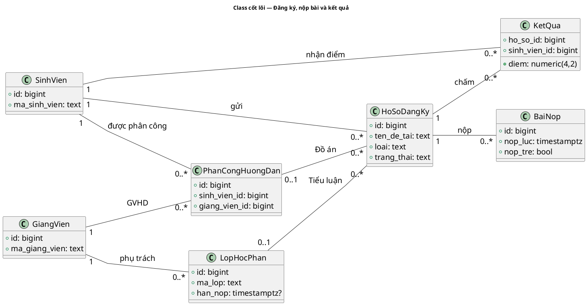

# Sơ đồ Class cốt lõi cho slide

Sơ đồ chọn 7 lớp ORM đang có trong `BE/app/models` để thể hiện luồng đăng ký → nộp bài → kết quả. Chỉ hiện thuộc tính và quan hệ chính để đọc được trên slide; các bảng còn lại nằm trong [thiết kế CSDL](04-thiet-ke-co-so-du-lieu.md). Chưa vẽ phương thức nghiệp vụ vì các phương thức đó chưa được triển khai trong model.

**Ghi chú thuyết trình:** Giảng viên phụ trách lớp và có thể làm GVHD; sinh viên gửi hồ sơ. Hồ sơ Tiểu luận gắn lớp, còn hồ sơ Đồ án đã duyệt gắn phân công GVHD. Một hồ sơ có thể có nhiều bài nộp và có một dòng `KetQua` cho mỗi sinh viên được chấm.
